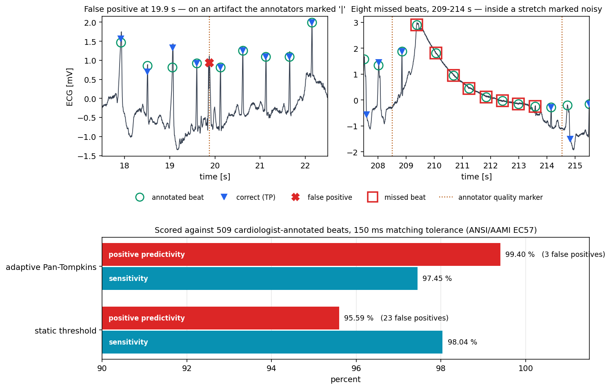
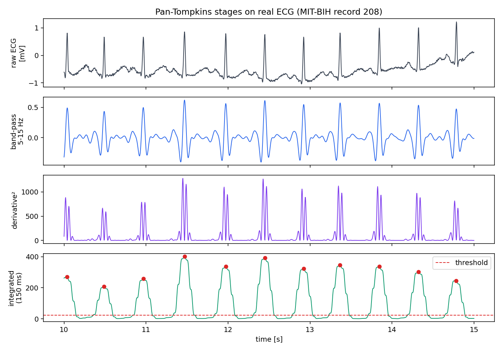
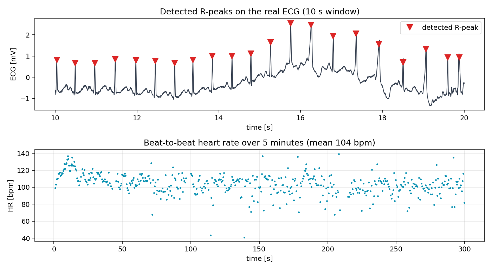

# QRS Detection on a Real ECG — Pan & Tompkins, Built and Measured

The Pan-Tompkins QRS detector implemented from scratch, then **scored against the beat
annotations cardiologists made on the same recording** using the standard evaluation
protocol — not just run and eyeballed.

**What this is, plainly:** Pan-Tompkins is a well-known 1985 algorithm that thousands of
people have implemented; there is nothing novel being claimed here. This is a learning
exercise — I wanted to actually understand *why* the algorithm is built the way it is,
which meant implementing the "boring" adaptive-threshold logic that most from-scratch
versions skip, and then holding myself to the same standard a real detector would be held
to: score it against ground truth instead of assuming it works because the plot looks
reasonable. The result below is the outcome of doing that, not a research contribution.

| | detected | TP | FP | FN | Sensitivity | Positive predictivity |
|---|---:|---:|---:|---:|---:|---:|
| static threshold | 522 | 499 | 23 | 10 | 98.04 % | 95.59 % |
| **adaptive Pan-Tompkins** | 499 | 496 | **3** | 13 | **97.45 %** | **99.40 %** |

*509 cardiologist-annotated beats · 150 ms matching tolerance (ANSI/AAMI EC57)*



---

## The point of this project

Anyone can implement a band-pass filter and call `find_peaks`. Two things separate that
from a real QRS detector, and this project is about both.

**First, the thresholding is the algorithm.** The filter chain — band-pass, derivative,
squaring, moving-window integration — is the easy half and every implementation has it.
What Pan and Tompkins actually contributed is the decision stage: running signal and noise
peak estimates that adapt continuously, RR-interval limits with *search-back* to recover
beats missed during a dropout, and T-wave rejection by slope comparison. Most from-scratch
implementations skip all of that and use one fixed threshold.

Both versions are implemented here so the difference can be measured rather than asserted.
**Replacing the fixed threshold with the real adaptive logic cuts false positives from 23
to 3.** Sensitivity drops slightly — the adaptive version is more conservative in noise —
and that trade is visible in the table instead of hidden.

**Second, a detector without a ground truth is a demo.** The reference annotations for
MIT-BIH are available, so there is no excuse for not scoring against them. `tools/`
contains the script that fetches them and locates this excerpt inside the full record.

---

## Where the errors actually are

Every error was checked against the annotators' own signal-quality markers — `~` for a
change in signal quality, `|` for an isolated QRS-like artifact.

| | errors | in an annotator-flagged stretch | outside |
|---|---:|---:|---|
| static threshold | 33 | 23 (70 %) | 10, scattered across normal, fusion and PVC beats |
| **adaptive Pan-Tompkins** | **16** | **14 (88 %)** | **2 — both isolated PVCs** |

The adaptive detector's residual errors are almost entirely explained by the recording, not
the algorithm:

- The single false positive at **19.9 s** lands exactly on a sample the annotators
  labelled `|` — *an isolated QRS-like artifact*. The detector fired on something that
  genuinely looks like a QRS and that the reference deliberately excludes from the beat
  list. Counting it as an error is arguably unfair to the detector.
- The run of **eight consecutive missed beats between 209 s and 214 s** sits inside a
  segment bracketed by quality markers at 208.5 s and 214.5 s. The right-hand panel above
  shows why: the baseline swings through 5 mV, which is motion artifact, and the beats ride
  down its flank.
- Only **two** errors — isolated premature ventricular contractions at 113.5 s and
  138.0 s — have no such explanation.

---

## The data

A 5-minute excerpt of **MIT-BIH record 208** at 360 Hz: samples 422820–530820 of the full
record, the excerpt distributed with SciPy as `scipy.datasets.electrocardiogram`. That
offset was not assumed — `tools/fetch_annotations.py` locates the excerpt inside the full
record by direct sample matching, and finds it at 422820 with a residual of zero.

Record 208 is deliberately a hard case. Of its 509 beats in this window:

| | count |
|---|---:|
| normal | 358 |
| premature ventricular contractions | 93 |
| fusion beats | 56 |
| unclassifiable | 2 |

**29 % of the beats are abnormal**, and the annotators flagged 14 signal-quality events.
Published Pan-Tompkins performance — Se 99.3 %, PPV 99.5 % — is averaged across all 48
records; this one is materially harder than that average, which is the point of choosing it.

See [`data/README.md`](data/README.md) for citation and licence.

---

## Pipeline



1. **Band-pass 5–15 Hz** — keeps QRS energy, rejects baseline wander, T waves and mains hum.
2. **Derivative** — QRS complexes are steep; P and T waves are not.
3. **Squaring** — makes everything positive and amplifies the steep parts nonlinearly.
4. **Moving-window integration, 150 ms** — roughly one QRS width, turning the spiky
   derivative into one hump per beat.
5. **Decision** — static or adaptive, as above.
6. **Refinement** — each detection is moved onto the largest deflection within ±50 ms.



---

## Running it

```bash
pip install -r requirements.txt
python ecg_qrs_pan_tompkins.py
```

Runs entirely offline from the three files in `data/` — no download, no internet needed for
this step. It regenerates every figure in `figures/` and `metrics.txt` in place, and the
numbers should come out identical to the ones in this README (499 detections, 3 false
positives, PPV 99.40 %). If they don't, something about the environment differs and that's
worth knowing.

To regenerate the ground-truth annotation files from PhysioNet (needs network and `wfdb`,
which is not a dependency of the main script):

```bash
pip install wfdb
python tools/fetch_annotations.py
```

---

## Why this project exists

QRS detection is the front end of nearly every ECG application — arrhythmia classification,
heart-rate variability, cardiac gating. I work on
[wearable ultrasound blood-pressure monitoring](https://github.com/ku-bmdl/us-bp-fiwus)
at the Bio-Integrated Microdevices Laboratory, Koç University, where beat detection triggers
the acquisition window for each pulse. Getting it right on a noisy record, and knowing
exactly which beats it misses and why, is the difference between a pipeline that works on a
bench and one that works on a person.

---

## Licence

Code is MIT (see [LICENSE](LICENSE)). The MIT-BIH data carries its own citation
requirements — see [`data/README.md`](data/README.md).

## Reference

Pan, J. and Tompkins, W.J. "A Real-Time QRS Detection Algorithm."
*IEEE Transactions on Biomedical Engineering*, BME-32(3), 230–236, 1985.
